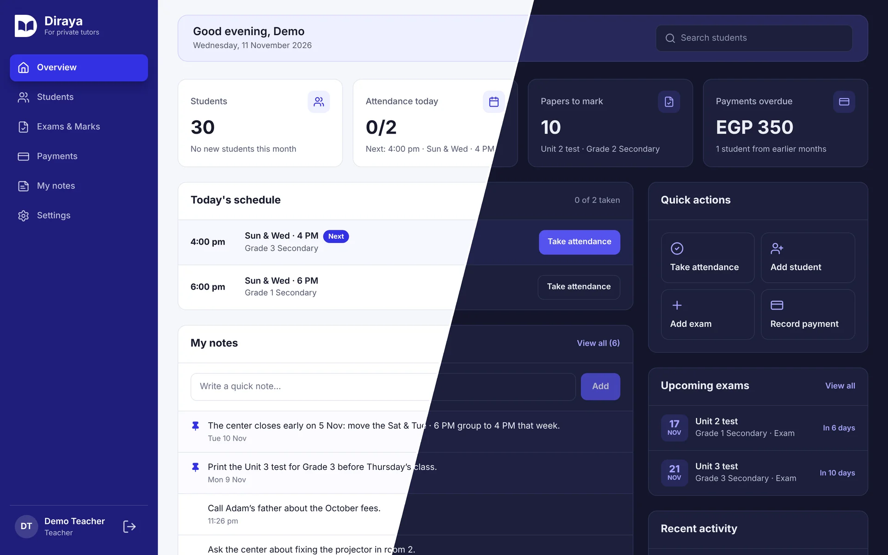
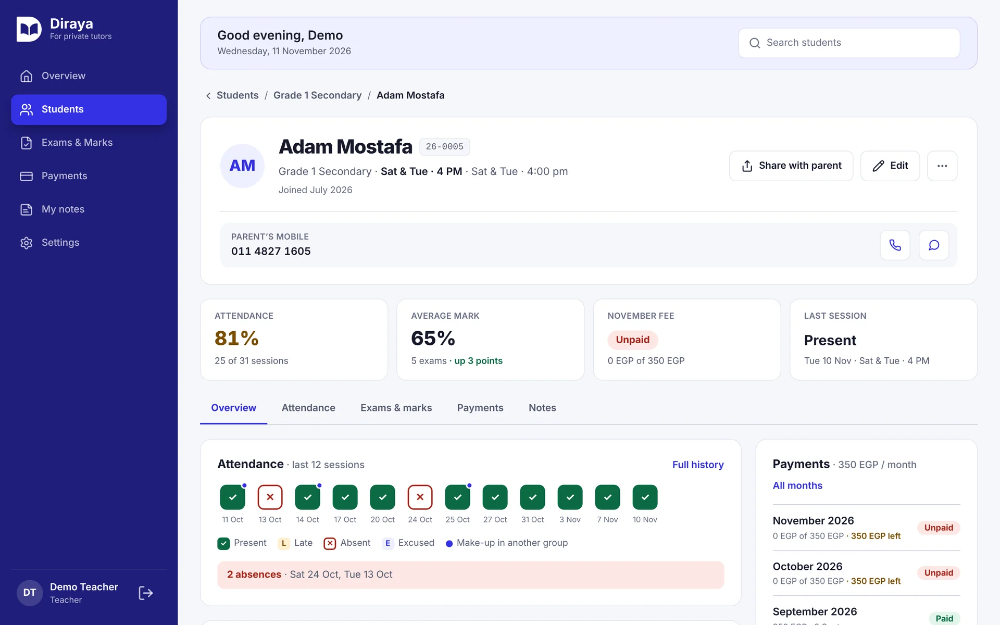
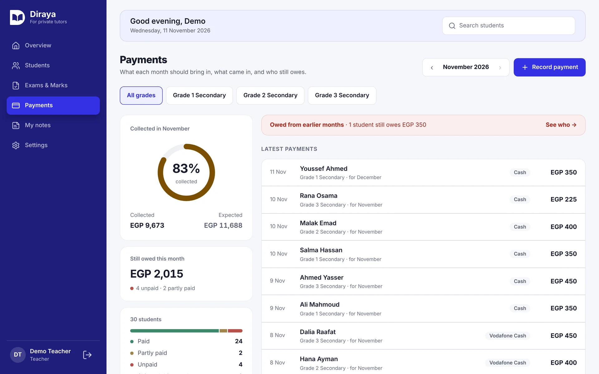
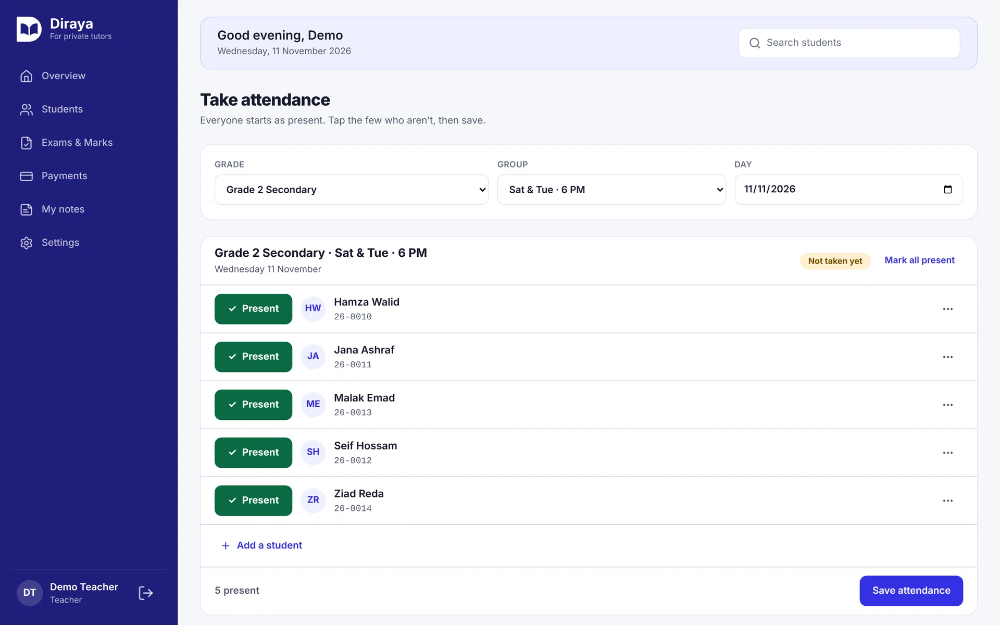
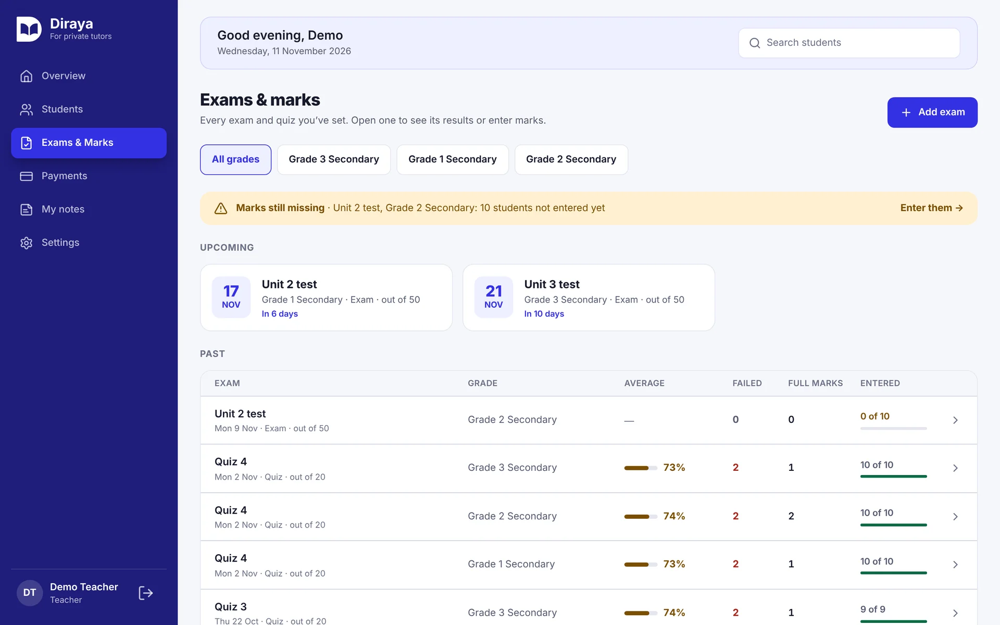
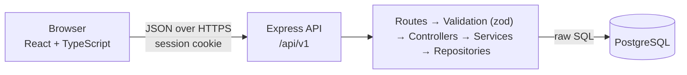

# Diraya

**A management platform for private tutors in Egypt: students, groups, attendance, exams, marks and payments in one place.**

<!-- Replace with the real links once deployed -->
[Live demo](https://YOUR-FRONTEND-URL) · [Portfolio case study](https://YOUR-PORTFOLIO-URL/projects/diraya)

> **Try it without signing up:** click **Try the demo** on the sign-in page. You get your own temporary teacher account, filled with sample data and deleted after 24 hours.

<!-- Copy the images from ahmed-portfolio/frontend/public/projects/diraya/ into docs/screenshots/ -->


---

## Contents

- [Features](#features)
- [Screenshots](#screenshots)
- [Tech stack](#tech-stack)
- [Architecture](#architecture)
- [Engineering decisions](#engineering-decisions)
- [Getting started](#getting-started)
- [Tests](#tests)
- [Project structure](#project-structure)
- [Roadmap](#roadmap)

## Features

- **Students, grades and groups**: organise students by school grade and class group, each group with its weekly timetable.
- **Attendance**: take a whole class in one screen (present, late, absent, excused), including make-up students from another group of the same grade.
- **Exams and marks**: exams and quizzes with a pass mark, half marks, absences, and each student's progress over time.
- **Payments**: monthly fees with discounts, cash / InstaPay / Vodafone Cash, collected vs outstanding month by month, voiding with a reason.
- **Reports for parents**: a student update sent on WhatsApp as text, or downloaded as a PDF.
- **Overview page**: today's classes, papers to mark, overdue payments, recent activity and personal notes.
- **Accounts**: email + password with email verification and password reset, Google sign-in, a one-click demo, light and dark themes.

## Screenshots

| Student profile | Payments |
| --- | --- |
|  |  |
| **Attendance** | **Exams & marks** |
|  |  |

## Tech stack

| Layer | Tools |
| --- | --- |
| Frontend | React 19, TypeScript, Vite, Tailwind CSS v4, React Router 7, @react-pdf/renderer, dnd-kit |
| Backend | Node.js, Express 5, TypeScript, zod |
| Database | PostgreSQL, raw SQL with `pg` (no ORM), node-pg-migrate |
| Auth | argon2 password hashing, JWT in an httpOnly cookie backed by a server-side session, Google OAuth |
| Email | Resend |
| Tests | node:test + tsx against a real test database |

## Architecture



- **Backend:** one folder per feature in `backend/src/modules/`, split into layers. Controllers only translate HTTP, services hold the business rules, repositories hold the SQL.
- **Frontend:** `api/` (requests) → `hooks/` (loading, errors, writes) → pages and components. Pages never call `fetch` directly.
- **Every teacher sees only their own data:** each route under `/teacher` requires a session, and every query is scoped to the signed-in teacher.

## Engineering decisions

<!-- Keep the 4–6 you can explain best in an interview -->

- **Raw SQL instead of an ORM.** Every query is written and reviewed by hand, and the schema is versioned with migrations that can be rolled back.
- **The database enforces the rules too.** CHECK constraints guard money, marks and phone formats, and composite foreign keys stop a record from pointing at another grade's data. A bug in the API can't save an impossible row.
- **Revocable sessions.** The JWT carries a session ID that is checked against a `teacher_sessions` row on every request, so signing out, or changing the password, ends a session immediately.
- **All-or-nothing writes.** Multi-step changes (saving an attendance sheet, a password reset, creating a demo account) run in one transaction.
- **Safe to retry.** Recording a payment carries a request ID, so a double click or a retried request can't charge a student twice.
- **A private demo per visitor.** Each "Try the demo" creates a separate teacher filled with sample data, so visitors never see each other's changes.

## Getting started

### Prerequisites

- Node.js 22+
- PostgreSQL (developed on 16)

### 1. Install

```bash
git clone https://github.com/ahmed-sami9/Diraya.git
cd Diraya
npm install
npm install --prefix backend
npm install --prefix frontend
```

### 2. Environment variables

Copy the examples and fill them in:

```bash
cp backend/.env.example backend/.env
cp frontend/.env.example frontend/.env
```

**Backend (`backend/.env`)**

| Variable | What it is |
| --- | --- |
| `DATABASE_URL` | PostgreSQL connection string |
| `JWT_SECRET` | Long random string used to sign session tokens |
| `FRONTEND_ORIGIN` | The frontend's address, for CORS, the CSRF check and email links |
| `GOOGLE_CLIENT_ID`, `GOOGLE_CLIENT_SECRET` | Google OAuth credentials |
| `RESEND_API_KEY` | Optional locally: without it, emails are printed in the terminal |
| `EMAIL_FROM` | Sender on a domain verified in Resend |
| `PORT`, `NODE_ENV` | Server port and environment |

**Frontend (`frontend/.env`)**

| Variable | What it is |
| --- | --- |
| `VITE_API_URL` | The API's base address, e.g. `http://localhost:5000/api/v1` |
| `VITE_GOOGLE_CLIENT_ID` | Same Google client ID as the backend |

### 3. Database

```bash
createdb diraya_app_db
npm run migrate up --prefix backend
```

### 4. Run

```bash
npm run dev
```

This starts the API on `http://localhost:5000` and the app on `http://localhost:5173`.

## Tests

The backend tests run against a **real PostgreSQL database**, so the SQL, the constraints and the transactions are tested too. A guard refuses to run them on any database whose name doesn't contain `_test`.

```bash
# once: create the test database and its .env.test, then
npm run migrate:test --prefix backend
npm test --prefix backend

# frontend logic (dates, ordering, reports, parent messages)
npm test --prefix frontend
```

<!-- Update the numbers when they change -->
About 300 backend tests cover the API and the repositories: permissions (another teacher's data), validation, business rules and database constraints.

## Project structure

```text
Diraya/
├── backend/
│   ├── migrations/          # versioned schema changes (node-pg-migrate)
│   ├── server.ts            # starts the server
│   └── src/
│       ├── app.ts           # Express app: CORS, CSRF check, routes, errors
│       ├── middlware/       # validation and error handling
│       └── modules/         # one folder per feature: routes, validation, controller, service, repository
└── frontend/
    └── src/
        ├── api/             # requests to the backend
        ├── hooks/           # data loading and writes for the pages
        ├── context/         # auth and theme
        ├── components/      # shared UI
        └── pages/           # sign-in and the teacher dashboard
```

## Roadmap

- Student and parent portal
- Arabic interface with right-to-left layout
- End-to-end tests with Playwright

---

Built by **Ahmed Elgaml** · [GitHub](https://github.com/ahmed-sami9) <!-- add LinkedIn / portfolio -->
